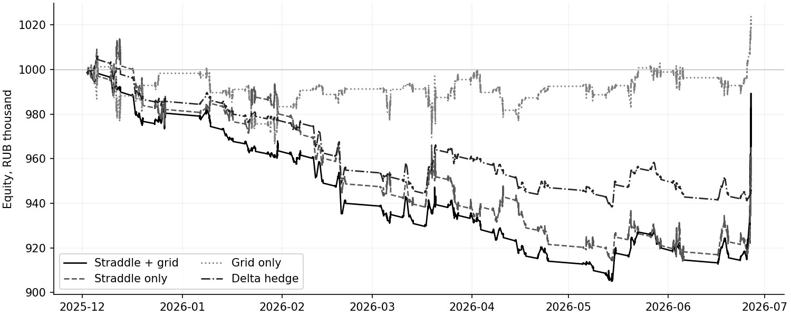

# Стрэддл и грид на Si

[Репозиторий решения](https://github.com/kornelikart/ml_test.git)

FamilyBroker · Задание 3

Стрэддл с фиксированной сеткой потерял 26,4 тыс. ₽ на исходной истории и 66,1 тыс. ₽ на контрольной. На каждом периоде стартовый капитал отдельный, 1 млн ₽. Новая проверка не подтвердила устойчивую прибыльность; модельные опционные цены и исполнение остаются основными ограничениями.

## Данные и проверка без подбора параметров

Исходная выборка: декабрь 2025 - июнь 2026, 26 циклов, 53 285 минутных свечей. Контроль: июль–октябрь 2026, 17 циклов; правила зафиксированы в PROTOCOL_V2.md до загрузки этого периода. Использованы реальные фьючерсы и дневные SETTLEPRICE опционов MOEX. IV восстанавливается из суммы call и put моделью Black; применяется только со следующей даты. Это модельная внутридневная переоценка, не архив исполнимых bid/ask.

## Конструкция и исполнение

Во вторник после 10:00 приобретаются 20 call и 20 put ближайшего страйка. Целевой DTE 14; на исходной выборке фактически 7–16 дней. Серия доступна в цепочке понедельника, страйк выбирается по цене входа. Выход в пятницу до 18:40, до экспирации; ролл не нужен. Диапазон K±P, где P - стоимость пары без издержек; шаг h=round(P/8), q=max(1, round(20Γ₀h)), обычно 2 фьючерса. Лимит |I|≤20.

Ночью заявки сняты, инвентарь сохраняется. Первую минуту каждого дня сетка наблюдает рынок. Затем каждый лимит пересоздаётся по предыдущей цене: покупка строго ниже, продажа строго выше. Исполнение требует прохода на тик и объёма q≤floor(1% объёма свечи), максимум одна сделка. При проходе обеих сторон свеча пропускается. После пробоя диапазона сетка выключается; базовый вариант держит инвентарь до пятницы. Очередь и порядок внутри свечи неизвестны.

| Стратегия | Исходный P&L¹ | Контроль P&L¹ | DD контроля |
| --- | --- | --- | --- |
| Стрэддл и грид | -26,4 | -66,1 | 7,29% |
| Стрэддл | -46,8 | -17,4 | 4,83% |
| Грид | 20,5 | -48,8 | 6,57% |
| Дельта-хедж | -56,5 | -72,2 | 7,38% |

¹ Тысячи рублей после затрат. Для каждой стратегии отдельный счёт. Пороговый дельта-хедж: |20Δ+I|≥2, сделка на следующем открытии; ночной приказ отменяется. Sharpe связки: −0,44 / −3,22; максимальная просадка: 9,62% / 7,29%. Sharpe по дневным доходностям × √252, без процентов на свободный остаток; просадка по минутным модельным отметкам. Просадка учитывает только наблюдения с 10:00 до 18:39 МСК. Вечерние экстремумы могут увеличить фактическую просадку.

# Экономика и устойчивость результата

Длинный стрэддл даёт положительную гамму и вегу, отрицательную тету. Сетка частично выполняет гамма-скальпинг, но её фиксированный объём не следует за изменением гаммы. Дельта позиции равна 20Δ+I; покупка q добавляет q, продажа вычитает q. В отличие от порогового хеджа, после пробоя сетка перестаёт корректировать дельту. На контроле связка потеряла меньше дельта-хеджа, но больше стрэддла без дополнительных сделок.

| Компонент, тыс. ₽ | Исходный | Контроль |
| --- | --- | --- |
| Дельта | +10,0 | +50,6 |
| Гамма | +151,7 | +82,0 |
| Тета | -133,0 | -89,3 |
| Вега | -3,7 | -12,8 |
| Остаток | +0,2 | +0,2 |
| Грид до затрат | +25,9 | -44,9 |
| Все затраты | -77,6 | -51,9 |
| Итог | -26,4 | -66,1 |

Разложение по предыдущим грекам: ΔdF+Γ(dF)²/2+Θdt+νdIV, остаток обеспечивает точную сверку с ценой. Гамма не прибавляется повторно сверх полного опционного P&L. Funding=0: используются срочные фьючерсы.

Издержки - сценарные допущения: maker/taker 2/4 ₽ на фьючерс и сторону, taker-проскальзывание 2 пункта; опцион 5 ₽ на контракт и сторону. Полуспред пары max(2,5% P, 20 ₽) при входе и выходе. Модельное ГО: 15% стоимости фьючерсного инвентаря и 5% на каждую опционную ногу; капитал под ГО стоит 15% годовых, ACT/365, без взаимозачёта. Полная премия маржируемого опциона не списывается авансом.

| Заранее заданная проверка | Исходный¹ | Контроль¹ |
| --- | --- | --- |
| Фиксированная сетка | -26,4 | -66,1 |
| Объём по текущей гамме | -52,3 | -63,2 |
| Закрытие инвентаря на границе | -72,3 | -74,6 |
| Оборот обеих ног накануне ≥20 | -22,7 | 6,8 |
| Полуспред 1% / нижний предел сохранён | 6,3 | -44,4 |
| Полуспред 5% | -82,5 | -103,5 |
| Условное время оценки 18:45 | -76,4 | -59,3 |

¹ Тысячи рублей. Фильтр оборота оставляет только 6 / 5 циклов; остальные строки - 26 / 17. Изменение времени оценки не означает знания настоящей временной метки. Все результаты приведены в results/sensitivity.csv и comparison_v2.csv.

На исходном периоде шаг P/16 и P/4 дал −28,5 и −33,1 тыс. ₽, объём 1 и 3 лота - −36,6 и −24,9 тыс. ₽. Полуширина 0,5P и 1,5P дала −42,2 и −14,9 тыс. ₽. Целевые сроки 7, 21 и 28 дней дали −12,4, −76,5 и −79,0 тыс. ₽.

На исходном периоде средние RV/IV - 18,1%/17,5%, на контроле 15,7%/16,7%. При RV>IV прибыльны только 5 из 15 и 1 из 5 циклов соответственно. Для идеального хеджа источник дохода примерно ½NΓF²(RV²−IV²)dt, но фиксированная сетка оставляет дельту, изменение IV и расходы. Универсального достаточного порога RV/IV нет. Сужение спреда до 1% даёт небольшой плюс на исходной истории, но сохраняет убыток на контроле.

# Риск и ограничения

| Цикл исходного периода | Опционы¹ | Грид¹ | Итог² |
| --- | --- | --- | --- |
| 2026-06-23 - лучший | +33,7 | +27,8 | +58,1 |
| 2025-12-16 - худший | -14,7 | +4,8 | -13,2 |
| 2026-01-20 - типичный | +13,5 | -15,2 | -4,4 |

Тысячи рублей; ¹ до затрат, ² после затрат. Типичный - ближайший к медиане. Графики цены, уровней, сделок, инвентаря и дельты находятся в results/cycle_*.png; для контроля - results_oos/cycle_*.png.

23 июня рост помог одновременно опционам и оставшемуся длинному инвентарю. Один этот цикл дал +58,1 тыс. ₽: результат сильно сконцентрирован. 16 декабря падение IV (−8,1 тыс. ₽ по веге) и тета (−6,5 тыс. ₽) перевесили доход сетки. 20 января прибыль опционов не покрыла убыток длинного инвентаря при снижении цены и расходы. Худшие 5% исходной выборки - два цикла, в среднем −12,9 тыс. ₽; на контроле это одно наблюдение −12,8 тыс. ₽. Надёжной оценки редких хвостов такой объём не даёт. 10 февраля опционы потеряли 7,9 тыс. ₽, сетка — 1,7 тыс. ₽ до затрат. 13 октября убыток опционов 11,6 тыс. ₽ перевесил прибыль сетки 1,7 тыс. ₽ до затрат.

## Обеспечение и выход из диапазона

22 января при выходе вниз цена была 77 473, инвентарь +12 фьючерсов; его P&L −10,3 тыс. ₽ против +7,7 тыс. ₽ опционов до затрат. Стресс ещё −10% при неизменных IV и времени даёт опционной ноге +147,4 тыс. ₽, инвентарю −93,0 тыс. ₽. При +24 фьючерсах суммарное изменение уже −38,5 тыс. ₽. Предельная дельта крыла - 20 контрактов; при m однонаправленных исполнениях критический q≈20/m. Лимит |I|≤20 не исключает промежуточный убыток и кассовый разрыв.

Капитал переносится между неделями. Вход запрещён при нехватке средств на модельное ГО и резерв затрат. Если после минуты свободный остаток отрицателен, всё закрывается на следующем доступном открытии с издержками и риском гэпа. В базовых расчётах ликвидаций нет; минимальный остаток после ГО и резерва - 580,6 / 575,4 тыс. ₽. Это модельное обеспечение; реальный график ВМ и риск-параметры НКЦ не восстановлены.

## Границы вывода

Оборот хотя бы одной опционной ноги ниже позиции в 20/26 и 12/17 циклов. Положительный итог фильтра на пяти контрольных циклах не доказывает исполнимость или устойчивость. Не восстановлены bid/ask, очередь, реальная задержка, intraday IV, smile и досрочное исполнение. Выход до экспирации уменьшает pin-риск; ролл и биржевые сбои требуют отдельного теста. Нужны котировки и новый контрольный период до дальнейшего отбора параметров. Честный вывод: гипотеза устойчивой прибыли не подтверждена.
